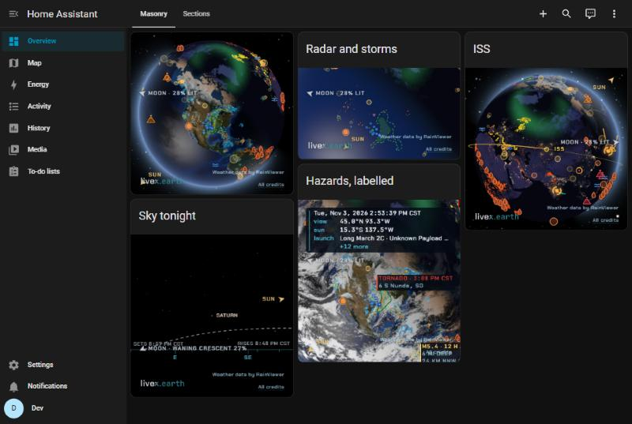

# livex.earth card for Home Assistant

A dashboard card showing [livex.earth](https://livex.earth/), the live globe: the Earth lit by
the real Sun, with hourly clouds, radar, severe weather, lightning, tropical storms, fires,
earthquakes, aurora, satellites and rocket launches. It faces your home by default, and
shows times on your clock and readings in your units.



The card is the livex.earth page in a frame. Every key in the card's YAML is one of livex's URL
parameters, so a dashboard can show any view livex.earth can.

```yaml
type: custom:livex-card
title: Weather near home
mag: 2.6
lightning: false
```

## Installing

**HACS:** search HACS for **livex.earth card**, download it, and reload the browser. Or let
the button open its page in your Home Assistant's HACS:

[](https://my.home-assistant.io/redirect/hacs_repository/?owner=rdmiller&repository=ha-livex&category=plugin)

If the search doesn't find it (an older HACS, or a store that hasn't refreshed yet), add it as
a custom repository: HACS → ⋮ → Custom repositories → `https://github.com/rdmiller/ha-livex`,
type **Dashboard**.

**By hand:** download `livex-card.js` from the [latest release](https://github.com/rdmiller/ha-livex/releases/latest)
into `config/www/`, then add it under Settings → Dashboards → ⋮ → Resources as
`/local/livex-card.js`, type **JavaScript module**.

Then add a card and pick **livex.earth**, or write `type: custom:livex-card` in YAML.

## The card's own options

| Key | Meaning | Default |
|---|---|---|
| `title` | a header above the globe | none |
| `aspect_ratio` | the globe's shape: `16:9`, `4/3`, `1.5`, or the Webpage card's `56%`. A sections view sizes the card itself, from its grid rows | `1` (square) |
| `height` | a fixed height (`400px`, `50vh`) in place of the aspect ratio | none |
| `interactive` | `false`: the globe can't be dragged or clicked, so a phone scrolls past it | `true` |
| `home` | `false`: don't fill in the home's position when `lat`/`lon` aren't given | `true` |
| `base_url` | another livex host, for a self-hosted copy | `https://livex.earth/` |

## livex.earth's options

Every other key goes into the page's URL: `true`/`false` become `1`/`0`, and a list is joined
with commas. Where the YAML doesn't say, the card asks for livex's embedded view:

- **`embed`:** `1`: just the globe, the wordmark and the data credits, with no panels or
  controls, and the globe still turns and zooms. It also makes livex's defaults quieter: no
  status readout, no label cards beside hazards and launches (their markers stay), and no
  satellites but the one `view: track` follows. Set `label`, `callouts`, `sats` or `satshow`
  to have them back, or `embed: false` for the full page. The wordmark and "All credits" open
  the view on livex.earth in a new tab.
- **`markers`:** `0`, no city names. `markers: true` brings them back.

And it fills in from Home Assistant:

- **`lat`, `lon`:** your home, rounded to a tenth of a degree (about 10 km), in the views where
  they name a place (`fixed`, the default, and `sky`).
- **`units`:** `imperial` or `metric`, from Home Assistant's unit system.
- **`hours`:** `12` or `24`, from your profile's time format.
- **`clock`:** `local`, so the readout shows your time zone, not UTC.

The quickest way to a view is to set it up on [livex.earth](https://livex.earth/): it writes
every change into the address bar, so the part after `?` is the card's config. For example
`?lat=38&lon=-97&mag=2.6&radar=0&winds=surface` becomes:

```yaml
type: custom:livex-card
lat: 38
lon: -97
mag: 2.6
radar: 0
winds: surface
```

The ones a dashboard most often wants:

| Key | Meaning | Default, embedded |
|---|---|---|
| `view` | `fixed` (over a place), `sky` (looking up from `lat`, `lon`), `sunrel` (following the Sun), `orbit`, `moon`, `track` | `fixed` |
| `mag` | size, 0.05–500 (2.6 shows a region, 10 a state) | `1` |
| `track` | for `view: track`: `iss`, `tiangong`, a NORAD number, or `launch` | `iss` |
| `clouds`, `radar`, `severe`, `lightning`, `storms`, `fires`, `quakes`, `tsunami`, `aurora`, `events`, `snow`, `launches`, `lights` | layers on or off | on |
| `markers` | city names | off |
| `borders`, `smoke`, `grid` | layers on or off | off |
| `imagery` | `live` (satellite pictures by day), `daily` (yesterday's, zoomed in), `painted` | `daily` |
| `winds` | `surface`, `jet` or `0`, as moving trails | `0` |
| `waves`, `currents` | moving trails over the sea | `0` |
| `sats` | `all`, `featured` (named only) or `0` | only the tracked one |
| `label` | the status readout: `1`, `short` or `0` | `0` |
| `callouts` | the label cards beside hazards and launches (a quake's magnitude and depth, a warning's area) | `0` |
| `latest`, `follow` | `latest: 1` shows the event log; with `follow` the globe turns to each new quake, launch, storm or alert | `0` |
| `tonight` | with `view: sky`, start the clock at tonight's dusk, looking at the Moon or the brightest planet | `0` |
| `sharp` | the globe's sharpness: `full`, `balanced` or `saver` | `full` |
| `logo` | the livex.earth wordmark, bottom left; the data credits stay without it | on |
| `hazmin` | the least serious hazard shown: `low`, `medium` or `high` | `low` |

## On a wall tablet

The globe is drawn with WebGL2. At rest it's redrawn only as often as something on it moves
half a pixel, about once a second at the default zoom, but moving trails (`winds`, `waves`,
`currents`) and a close zoom redraw it every frame, which a small tablet left on all day may
find heavy. `sharp: saver` draws it at one pixel per CSS pixel. Any browser with WebGL2 shows it, including the Home Assistant apps on Android and on
iOS 15 or later.

## Privacy

The page is loaded by the browser showing the dashboard, straight from livex.earth, with no
referrer, so livex.earth doesn't learn your Home Assistant's address. The URL it loads carries
the view's settings, including the home's rounded position unless you give your own `lat` and
`lon` or set `home: false`. Nothing goes through Home Assistant's server.

## Developing

```sh
pnpm install
pnpm typecheck && pnpm test && pnpm build   # dist/livex-card.js
bash dev/ha/up.sh                           # a throwaway Home Assistant at http://localhost:18123/
```

`dev/ha/up.sh` runs Home Assistant in Docker with `dist/` served as `/local/`, a home in
Minneapolis, and a dashboard of example cards (`dev/ha/lovelace.json`). It finishes onboarding
itself and lets this machine in without a password. Run `pnpm build` and reload the page after
a change; `docker rm -f livex-card-ha` stops it.

A release is made by publishing a GitHub release tagged `v` + the version in `package.json`;
its workflow builds `livex-card.js` and attaches it, which is the file HACS installs.

## Credits

The globe and its data credits are livex.earth's; the card only frames it. MIT licensed.
